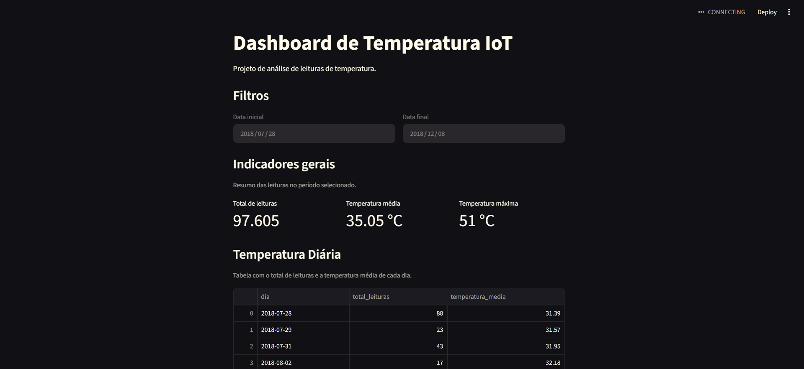
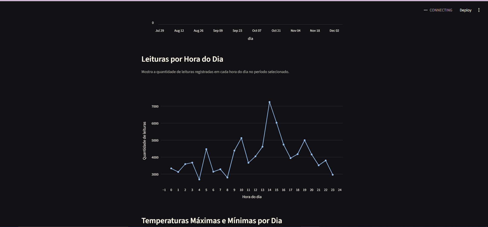
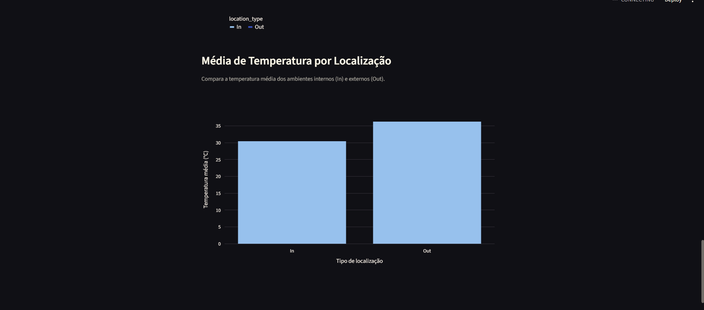
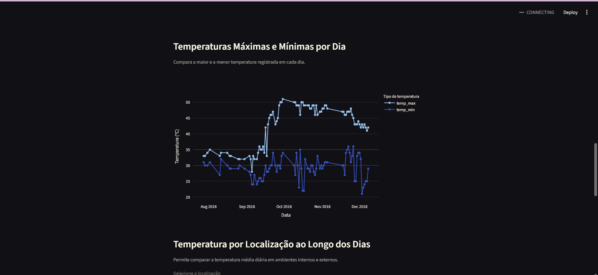

# IoT Data Pipeline — Temperature Analysis

## 1. About the Project

This project implements a data pipeline to process temperature readings collected from IoT devices, store them in a PostgreSQL database, and present the results through an interactive dashboard.

The goal is to practice Extract, Transform, Load (ETL) processes, SQL queries, and data visualization.

## 2. Technologies Used

- **Python:** data processing and integration.
- **Pandas:** dataset manipulation and transformation.
- **PostgreSQL:** data storage.
- **Docker and Docker Compose:** running the database in a container.
- **Streamlit:** dashboard development.
- **Plotly:** interactive data visualizations.
- **Psycopg2:** connection between Python and PostgreSQL.
- **python-dotenv:** environment configuration management.

## 3. Project Structure

```text
pipeline-iot-temperatura/
├── data/
│   └── IOT-temp.csv
├── docs/
│   └── imagens/
├── sql/
│   ├── create_table.sql
│   └── views.sql
├── src/
│   ├── dashboard.py
│   └── ingest.py
├── .env.example
├── .gitignore
├── docker-compose.yml
├── requirements.txt
└── README.md
```

## 4. Dataset

This project uses the **Temperature Readings: IoT Devices** dataset, available on Kaggle:

https://www.kaggle.com/datasets/atulanandjha/temperature-readings-iot-devices

The CSV file contains temperature readings, date and time information, record IDs, environment data, and an indication of whether the readings were collected indoors or outdoors.

To run the project, place the `IOT-temp.csv` file inside the `data/` directory.

## 5. Environment Setup

### Prerequisites

- Python installed
- Docker Desktop installed and running
- Git installed

### Environment Variables Configuration

Create a copy of the `.env.example` file and name it `.env`.

On Windows CMD, run:

```bat
copy .env.example .env
```

Edit the `.env` file and configure the required PostgreSQL connection variables. Use local values and set your own password.

### Installing Dependencies

From the project's root directory, create and activate a virtual environment if it does not already exist:

```bat
python -m venv .venv
.venv\Scripts\activate
```

Install the dependencies:

```bat
python -m pip install -r requirements.txt
```

## 6. Running PostgreSQL with Docker

Start the container:

```bat
docker compose up -d
```

Check the status of the services:

```bat
docker compose ps
```

PostgreSQL will be available on the port configured in `.env`.

## 7. Creating the Table and Views

Execute the SQL scripts in PostgreSQL. The database and user values in the commands below must match those configured in your `.env` file.

Create the table:

```bat
docker exec -i postgres-iot psql -U iot_user -d iot_db < sql\create_table.sql
```

Create the views:

```bat
docker exec -i postgres-iot psql -U iot_user -d iot_db < sql\views.sql
```

The scripts create the `temperature_readings` table and the following views:

- `vw_temperatura_diaria`
- `vw_temperatura_diaria_localizacao`
- `vw_classificacao_temperatura`

## 8. Running the ETL Pipeline

With PostgreSQL running and the table created, execute:

```bat
python src\ingest.py
```

The pipeline performs the following steps:

1. **Extraction:** reads the CSV file.
2. **Transformation:** removes duplicate records and converts data fields.
3. **Loading:** inserts the records into PostgreSQL.

The loading process uses `ON CONFLICT DO NOTHING` to prevent records with existing IDs from being inserted again.

## 9. Running the Dashboard

After loading the data and creating the views, execute:

```bat
python -m streamlit run src/dashboard.py
```

Streamlit will provide the local dashboard URL in the terminal. Open this URL in your browser.

The dashboard provides:

- Date range filters.
- Total number of readings.
- Average and maximum temperatures.
- Daily average temperature trends.
- Number of readings by hour.
- Daily maximum and minimum temperatures.
- Temperature comparisons by location.
- Average temperature comparison between indoor and outdoor environments.

## 10. SQL Queries

The SQL scripts are available in the `sql/` directory.

The views allow temperature readings to be summarized by day, different location types to be compared, and temperatures to be classified into low, moderate, and high ranges.

## 11. Dashboard Screenshots









## 12. Git Commands

To check modified files:

```bat
git status
```

To stage the files and create a commit:

```bat
git add .
git commit -m "Document IoT pipeline and dashboard"
```

To publish the project on GitHub, configure the remote repository and push the commits to the main branch.

**Important:** Make sure `.env`, `.venv/`, and other private files are excluded before running `git add .`.

## 13. Author

Academic project developed to practice data engineering, PostgreSQL integration, Docker, Python, and data visualization.