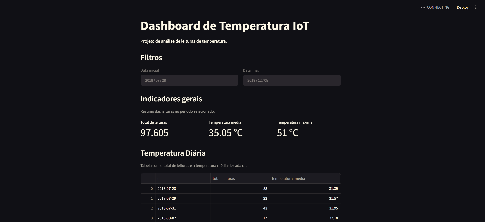
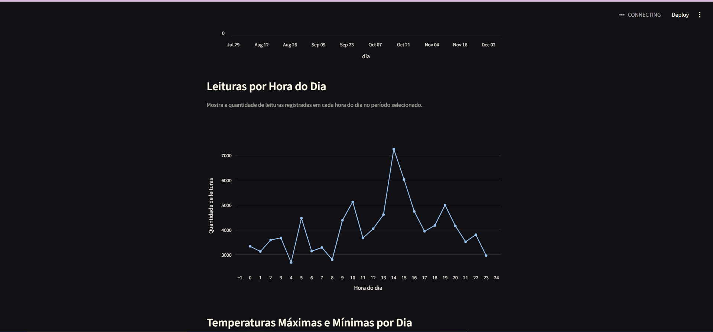
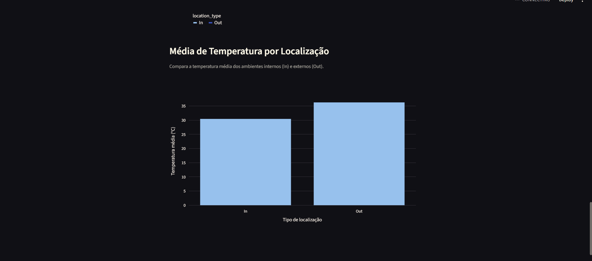
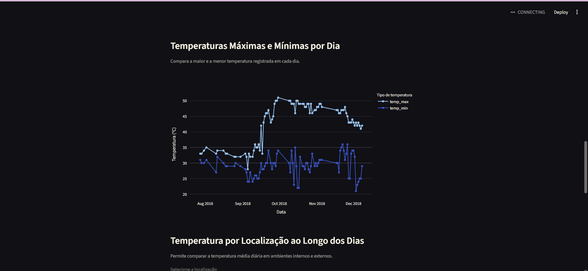

# Pipeline de Dados IoT — Análise de Temperatura

## 1. Sobre o projeto

Este projeto implementa um pipeline de dados para processar leituras de temperatura de dispositivos IoT, armazená-las em um banco de dados PostgreSQL e apresentar os resultados em um dashboard interativo.

O objetivo é praticar as etapas de extração, transformação e carregamento (ETL), consultas SQL e visualização de dados.

## 2. Tecnologias utilizadas

- **Python:** processamento e integração dos dados.
- **Pandas:** manipulação e transformação do dataset.
- **PostgreSQL:** armazenamento dos dados.
- **Docker e Docker Compose:** execução do banco de dados em container.
- **Streamlit:** construção do dashboard.
- **Plotly:** visualizações interativas.
- **Psycopg2:** conexão entre Python e PostgreSQL.
- **python-dotenv:** leitura das configurações do ambiente.

## 3. Estrutura do projeto

```text
pipeline-iot-temperatura/
├── data/
│   └── IOT-temp.csv
├── docs/
│   └── imagens/
├── sql/
│   ├── create_table.sql
│   └── views.sql
├── src/
│   ├── dashboard.py
│   └── ingest.py
├── .env.example
├── .gitignore
├── docker-compose.yml
├── requirements.txt
└── README.md
```

## 4. Dataset

O projeto utiliza o dataset **Temperature Readings: IoT Devices**, disponível no Kaggle:

https://www.kaggle.com/datasets/atulanandjha/temperature-readings-iot-devices

O arquivo CSV contém leituras de temperatura, data e hora, identificação do registro, ambiente e indicação de localização interna ou externa.

Para executar o projeto, coloque o arquivo `IOT-temp.csv` dentro da pasta `data/`.

## 5. Configuração do ambiente

### Pré-requisitos

- Python instalado
- Docker Desktop instalado e em execução
- Git instalado

### Configuração das variáveis de ambiente

Crie uma cópia do arquivo `.env.example` com o nome `.env`.

No Windows CMD, execute:

```bat
copy .env.example .env
```

Edite o arquivo `.env` e configure as variáveis necessárias para a conexão com o PostgreSQL. Utilize valores locais e uma senha própria. 

### Instalação das dependências

Na pasta raiz do projeto, crie e ative o ambiente virtual, caso ainda não exista:

```bat
python -m venv .venv
.venv\Scripts\activate
```

Instale as dependências:

```bat
python -m pip install -r requirements.txt
```

## 6. Execução do PostgreSQL com Docker

Inicie o container:

```bat
docker compose up -d
```

Verifique o estado dos serviços:

```bat
docker compose ps
```

O PostgreSQL ficará disponível na porta configurada em `.env`.

## 7. Criação da tabela e das views

Execute os scripts SQL no PostgreSQL. Os valores de usuário e banco nos comandos abaixo devem corresponder aos configurados no seu `.env`.

Criação da tabela:

```bat
docker exec -i postgres-iot psql -U iot_user -d iot_db < sql\create_table.sql
```

Criação das views:

```bat
docker exec -i postgres-iot psql -U iot_user -d iot_db < sql\views.sql
```

Os scripts criam a tabela `temperature_readings` e as views:

- `vw_temperatura_diaria`
- `vw_temperatura_diaria_localizacao`
- `vw_classificacao_temperatura`

## 8. Execução do pipeline ETL

Com o PostgreSQL em execução e a tabela criada, execute:

```bat
python src\ingest.py
```

O pipeline realiza as seguintes etapas:

1. **Extração:** leitura do arquivo CSV.
2. **Transformação:** remoção de registros duplicados e conversão dos campos.
3. **Carga:** inserção dos registros no PostgreSQL.

A carga utiliza `ON CONFLICT DO NOTHING` para evitar reinserções de registros com IDs já existentes.

## 9. Execução do dashboard

Após carregar os dados e criar as views, execute:

```bat
python -m streamlit run src/dashboard.py
```

O Streamlit disponibilizará o endereço local do dashboard no terminal. Abra esse endereço no navegador.

O dashboard apresenta:

- Filtros por período.
- Total de leituras.
- Temperatura média e máxima.
- Evolução diária da temperatura média.
- Quantidade de leituras por hora.
- Temperaturas máximas e mínimas por dia.
- Comparação de temperaturas por localização.
- Média de temperatura em ambientes internos e externos.

## 10. Consultas SQL

Os scripts SQL estão disponíveis na pasta `sql/`.

As views permitem resumir as leituras por dia, comparar os tipos de localização e classificar as temperaturas em faixas baixa, moderada e alta.

## 11. Imagens do dashboard

As capturas de tela do dashboard devem ser armazenadas em `docs/imagens/`.

Após adicionar as imagens ao repositório, elas podem ser exibidas aqui, por exemplo:

```markdown

```
```markdown

```
```markdown

```
```markdown

```

## 12. Comandos Git

Para verificar os arquivos modificados:

```bat
git status
```

Para adicionar os arquivos e criar um commit:

```bat
git add .
git commit -m "Documenta pipeline IoT e dashboard"
```

Para publicar no GitHub, configure o repositório remoto e envie os commits para a branch principal.

**Importante:** confirme que `.env`, `.venv/` e outros arquivos privados estão excluídos antes de executar `git add .`.


## 13. Autor

Projeto acadêmico desenvolvido para praticar engenharia de dados, integração com PostgreSQL, Docker, Python e visualização de dados.
